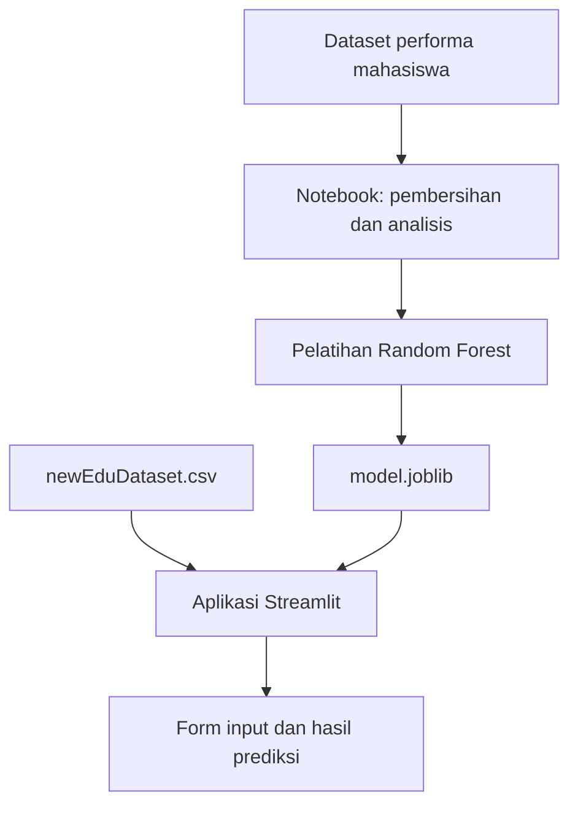
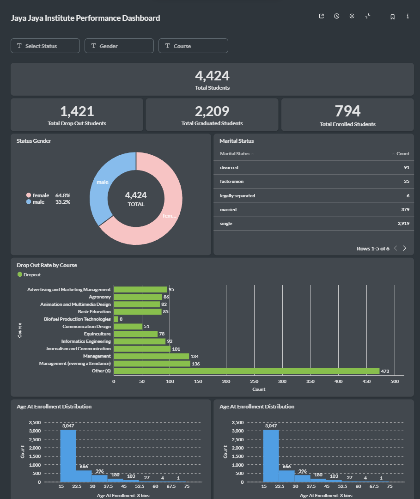

# Analisis dan Prediksi Performa Mahasiswa

Proyek ini mengeksplorasi faktor yang berkaitan dengan status studi mahasiswa. Repository berisi notebook analisis, sebuah aplikasi prediksi berbasis Streamlit, model tersimpan, data pendukung, dan gambar dashboard.

## Alur proyek



## Pratinjau




## Menjalankan aplikasi prediksi

Pastikan `app.py`, `model.joblib`, dan `newEduDataset.csv` berada di direktori proyek yang sama.

```bash
python -m venv .venv
```

Aktifkan virtual environment, lalu jalankan:

```bash
pip install -r requirements.txt
streamlit run app.py
```

Aplikasi meminta beberapa atribut mahasiswa melalui form dan menggunakan `model.joblib` untuk menghasilkan prediksi. Notebook analisis bernama `noteboook.ipynb` (ejaan nama file mengikuti repository).

## Isi utama

- `app.py`: antarmuka input dan prediksi Streamlit.
- `noteboook.ipynb`: analisis data dan eksperimen Random Forest.
- `model.joblib`: model yang dimuat oleh aplikasi.
- `newEduDataset.csv`: data untuk pilihan kategori di antarmuka.
- `requirements.txt`: dependency Python.
- `indradi-dashboard.png`: visual dashboard analisis.

## Catatan

Hasil prediksi hanya demonstrasi model pada dataset proyek; hasilnya bukan keputusan akademik. Jika model gagal dimuat, periksa kesesuaian versi scikit-learn yang digunakan saat model disimpan.
